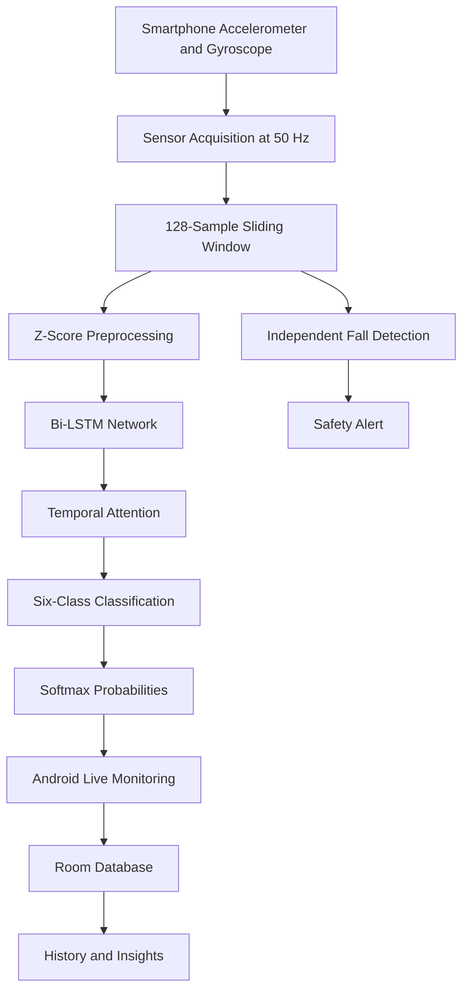

# MotionShield
### Privacy-Preserving Smartphone Human Activity Recognition & Safety Monitoring

**An Android-based deep learning system combining Bi-LSTM with Temporal Attention, real-time smartphone sensor processing, on-device inference, and independent safety-monitoring modules.**

<p align="center">

**Deep Learning · Android · PyTorch · Sensor Fusion · Mobile Edge Computing**

</p>

---

## Overview

MotionShield is an end-to-end Android application designed to recognize human activities and provide supplementary safety monitoring using smartphone motion sensors. It combines a custom-trained **Bidirectional Long Short-Term Memory (Bi-LSTM) network with Temporal Attention** and a collection of sensor-based safety modules in a single mobile application.

The core activity recognition model processes accelerometer and gyroscope data to classify six everyday activities. The trained model is deployed on Android through a TorchScript model, allowing inference to run locally without continuously transmitting raw sensor data to a remote server.

Beyond activity recognition, MotionShield includes an independent fall-detection engine, a driver-drowsiness monitoring prototype, experimental wrist-pulse estimation, local session history, activity analytics, and elderly safety guidance.

The project brings together **deep learning, time-series processing, Android development, local data persistence, and mobile inference** in a practical application.

## Key Features

| Feature | Implementation |
|---|---|
| Human Activity Recognition | Bi-LSTM with Temporal Attention |
| Activity Classification | Six UCI-HAR activity classes |
| Sensor Acquisition | Accelerometer and gyroscope |
| Real-Time Processing | 50 Hz target sampling with overlapping windows |
| Model Deployment | PyTorch TorchScript on Android |
| Prediction Confidence | Numerically stable softmax probabilities |
| Fall Detection | Independent sensor-based state machine |
| Driver Safety | Experimental drowsiness and motion-anomaly monitoring |
| Wrist Vitals | Experimental accelerometer-based pulse estimation |
| Session Persistence | Room database |
| Activity History | Session records, details, and insights |
| User Profiles | Local multi-profile switching |
| ML Diagnostics | Class probabilities, logits, and inference latency |
| Privacy | Local processing and device-local storage |

## System Architecture



The activity recognition and fall-detection components operate as separate subsystems. The HAR model predicts one of six activities, while the safety engine independently evaluates motion patterns for potential fall events.

### Processing Pipeline

1. **Sensor acquisition:** Read three-axis accelerometer and gyroscope measurements.
2. **Windowing:** Maintain a rolling buffer of 128 samples with a stride of 25 samples.
3. **Preprocessing:** Arrange six sensor channels and apply training-derived normalization.
4. **Inference:** Execute the trained Bi-LSTM and Temporal Attention model locally.
5. **Classification:** Convert model logits into normalized class probabilities.
6. **Application output:** Display activity predictions and confidence, monitor safety events, and persist completed sessions locally.

## Machine Learning Model

### Bi-LSTM with Temporal Attention

The model learns temporal patterns from sequential inertial sensor measurements. The bidirectional LSTM processes each observation window in forward and backward directions, capturing temporal relationships across the sequence. A temporal attention layer assigns learned weights to the resulting hidden states and combines them into a context representation for classification.

| Parameter | Configuration |
|---|---|
| Input shape | `[batch, 128, 6]` |
| Sensor channels | 3-axis acceleration + 3-axis gyroscope |
| LSTM architecture | 2-layer bidirectional LSTM |
| Hidden size | 128 per direction |
| Attention dimension | 64 |
| Dropout | 0.3 |
| Output classes | 6 |
| Loss function | Cross-entropy |
| Optimizer | Adam |
| Learning-rate scheduler | ReduceLROnPlateau |
| Model format | PyTorch TorchScript (`.pt`) |

### Activity Classes

| Index | Activity |
|:---:|---|
| 0 | Walking |
| 1 | Walking Upstairs |
| 2 | Walking Downstairs |
| 3 | Sitting |
| 4 | Standing |
| 5 | Laying |

**Dataset:** [UCI Human Activity Recognition Using Smartphones](https://archive.ics.uci.edu/dataset/240/human+activity+recognition+using+smartphones)

The dataset contains measurements from 30 volunteers performing six activities. The original benchmark uses smartphone accelerometer and gyroscope signals collected at 50 Hz.

### Reported Benchmark Results

The following are the reported held-out UCI-HAR evaluation results for the trained model.

| Metric | Score |
|---|---:|
| Accuracy | **94.57%** |
| Balanced Accuracy | 94.55% |
| Macro Precision | 94.62% |
| Macro Recall | 94.54% |
| Macro F1-Score | **94.58%** |
| Weighted F1-Score | 94.57% |

These figures describe benchmark evaluation performance. Predictions on physical smartphones can differ because of phone placement, orientation, movement patterns, and differences between real-world sensor signals and the training data.

## Real-Time Sensor Processing

MotionShield uses a rolling sensor buffer to generate overlapping input windows for inference.

| Processing parameter | Value |
|---|---|
| Target sampling rate | 50 Hz |
| Window length | 128 samples |
| Window duration | 2.56 seconds |
| Window stride | 25 samples |
| Nominal update interval | 0.5 seconds |
| Input channels | 6 |
| Normalization | Training-derived Z-score scaling |

The window duration represents the sensor history required for an inference. The nominal update interval represents how frequently a new prediction can be produced after the buffer is populated; it is not the same as the time required for the first prediction.

The Android pipeline includes numerical softmax normalization so that the six class probabilities sum to approximately one. Prediction confidence is derived from the highest class probability.

## Android Application

MotionShield organizes its functionality into dedicated screens and components.

| Screen or component | Purpose |
|---|---|
| Home | Overview, session summaries, and shortcuts |
| Live Monitoring | Activity prediction, confidence, and session controls |
| History | Saved sessions and activity records |
| History Details | Individual session information |
| Insights | Analytics derived from stored sessions |
| Profile | Local user-profile management |
| Activity Guide | Instructions for using the application |
| Elderly Safety | Practical safety guidance |
| ML Diagnostics | Probability vectors, logits, and inference information |
| Driver Safety | Experimental drowsiness monitoring |
| Wrist Vitals | Experimental pulse estimation |
| About | Application architecture and technical information |

### Session Management

Session state is managed through `LiveMotionViewModel`, while completed sessions are persisted using Android Room.

The application supports session start, pause, resume, stop-and-save, history retrieval, and session deletion. The database records session information such as duration, dominant activity, average confidence, prediction count, and inference latency.

## Independent Fall Detection

Fall detection is implemented separately from the six-class machine learning model. It uses a sensor-based state machine to assess motion patterns rather than introducing fall detection as an additional HAR class.

```text
NORMAL
   ↓
IMPACT CANDIDATE
   ↓
POST-IMPACT INACTIVITY CHECK
   ↓
POTENTIAL FALL ALERT
   ↓
USER ACKNOWLEDGMENT / RECOVERY
```

The documented prototype uses an acceleration threshold above approximately 2.5 g and a subsequent low-variance inactivity check over approximately two seconds. When the conditions are satisfied, the application presents an alert with an acknowledgment option.

These thresholds are heuristic parameters, not proof that a fall has occurred. Real-world validation is required to assess false alarms and missed events. MotionShield is not a certified emergency-response or medical device.

## Additional Safety Features

### Driver Drowsiness Monitoring

A separate Android screen explores motion-based detection of possible drowsiness-related head movements and unusual motion patterns. It includes warning and acknowledgment interfaces, haptic alerts, and a safe simulation option.

This is an experimental sensor-based prototype, not a validated driver-monitoring system. Smartphone motion alone cannot reliably establish that a driver is asleep or that a vehicle is swerving.

### Wrist Pulse Estimation

The wrist-vitals module explores accelerometer-based ballistocardiographic (BCG) pulse estimation using signal filtering and peak detection.

The application also displays an experimental blood-pressure estimate derived from a heuristic relationship with estimated pulse rate. **This estimate is not a validated blood-pressure measurement and must not be used for medical decisions.** Reliable pulse and blood-pressure assessment requires appropriate validated measurement equipment.

### Elderly Safety

The application provides guidance on safe walking, stair use, suitable footwear, clear walking paths, phone placement, rest, and emergency awareness. These features complement the monitoring interface but do not replace caregiver supervision or professional medical care.

## Privacy and Data Handling

Privacy is a central design objective of MotionShield.

- The HAR model runs locally on the Android device.
- Raw sensor data does not need to be uploaded to a cloud inference service.
- Session history is stored in the device-local Room database.
- User-profile selections are stored locally using SharedPreferences.
- Core activity recognition is designed to operate without a network connection.

The application’s privacy properties depend on its actual permissions, dependencies, and runtime behavior. Local inference alone does not establish a formal privacy certification.

## Technology Stack

| Layer | Technologies |
|---|---|
| Mobile Application | Android, Java, XML |
| UI Architecture | Activities, Fragments, Jetpack Navigation |
| Sensor Processing | Android SensorManager, accelerometer, gyroscope |
| Machine Learning | Python, PyTorch |
| Model Architecture | Bi-LSTM, Temporal Attention |
| Model Deployment | TorchScript, Android JNI/C++ bindings |
| Data Processing | NumPy, scikit-learn |
| Local Persistence | Room, SQLite |
| State Management | ViewModel, LiveData |
| Experimentation | Dataset preparation, model training, evaluation scripts |
| Testing | pytest, Android Gradle build |

## Repository Structure

```text
Human-Activity-Recognition/
├── frontend/
│   └── android/
│       └── app/src/main/
│           ├── assets/
│           │   ├── bilstm_attention.pt
│           │   ├── scaler_mean.json
│           │   └── scaler_std.json
│           ├── java/com/example/app/
│           │   ├── LiveMotionViewModel.java
│           │   ├── SensorBuffer.java
│           │   ├── Preprocess.java
│           │   ├── InferencePhone.java
│           │   ├── UserManager.java
│           │   ├── HomeFragment.java
│           │   ├── DashboardFragment.java
│           │   ├── HistoryFragment.java
│           │   ├── HistoryDetailFragment.java
│           │   ├── ProfileFragment.java
│           │   ├── InsightsFragment.java
│           │   ├── ElderlySafetyFragment.java
│           │   ├── MLDiagnosticsFragment.java
│           │   ├── DriverDrowsinessFragment.java
│           │   └── WristVitalCheckFragment.java
│           └── res/
│               ├── layout/
│               ├── drawable/
│               └── navigation/
├── ml/
│   └── models/
├── data/
│   └── adapters/
├── models/
│   └── smartphone_har/
├── scripts/
│   ├── prepare_dataset.py
│   ├── train.py
│   └── evaluate.py
├── configs/
├── reports/
├── tests/
├── requirements.txt
├── README.md
└── .gitignore
```

*The tree highlights the principal project components. Exact filenames and optional modules may vary with the current repository version.*

## Getting Started

### Prerequisites

- Android Studio with a compatible Android SDK and Gradle installation
- A physical Android device or compatible emulator
- Python 3.11 recommended for the ML pipeline
- Git

### Clone the Repository

```bash
git clone https://github.com/Jahnavi-Mogarala/Human-Activity-Recognition.git
cd Human-Activity-Recognition
```

### Build the Android Application

From the repository root:

```bash
cd frontend/android
```

On Windows:

```powershell
.\gradlew.bat clean assembleDebug
```

On macOS or Linux:

```bash
./gradlew clean assembleDebug
```

The debug APK is normally generated at:

```text
app/build/outputs/apk/debug/app-debug.apk
```

Install it on a connected device using:

```bash
adb install -r app/build/outputs/apk/debug/app-debug.apk
```

Use the full Android SDK platform-tools path if `adb` is not available on your system's `PATH`.

### Set Up the ML Environment

From the repository root, create and activate a virtual environment.

**Windows PowerShell**

```powershell
python -m venv .venv
.\.venv\Scripts\Activate.ps1
pip install -r requirements.txt
```

**macOS / Linux**

```bash
python3 -m venv .venv
source .venv/bin/activate
pip install -r requirements.txt
```

### Prepare the Dataset

Download and extract the [UCI-HAR dataset](https://archive.ics.uci.edu/dataset/240/human+activity+recognition+using+smartphones), then configure the dataset path according to the project’s configuration and data-preparation script.

Run:

```bash
python scripts/prepare_dataset.py
```

### Train and Evaluate the Model

```bash
python scripts/train.py
python scripts/evaluate.py
```

Training requires the dataset files and the paths expected by the project configuration. The Android application uses the bundled model and scaler assets, so retraining is not required simply to run the app.

### Run Automated Tests

```bash
python -m pytest -v
```

For reproducible results, retain the dataset version, split configuration, model checkpoint, preprocessing parameters, and evaluation output associated with each experiment.

## Physical Device Validation

The project has been exercised on a physical Android smartphone using the live-monitoring and ML-diagnostics screens. Reported observations indicate that static activities such as Sitting generally produce more stable predictions, while dynamic activities can show greater variation.

Performance can depend on phone placement, sensor orientation, walking speed, window boundaries, and the difference between hand-held use and the waist-mounted collection setup used by UCI-HAR.

The benchmark metrics and physical-device observations should therefore be evaluated separately. Confidence values observed during a demonstration are not substitutes for a controlled real-world accuracy study.

## Future Improvements

- Evaluate generalization across different phone models, placements, and users.
- Improve recognition of dynamic activities and transitions using broader validation data.
- Profile inference latency, memory usage, and battery consumption across devices.
- Explore model quantization and other mobile inference optimizations.
- Validate fall detection against labeled real-world events and report false-positive and false-negative rates.
- Evaluate the drowsiness and wrist-vitals modules independently before making stronger safety or health claims.
- Expand activity analytics and accessible monitoring interfaces.
- Introduce optional caregiver notifications only with appropriate user consent and secure data handling.

## Research Context

MotionShield is based on the UCI-HAR smartphone-sensor benchmark and explores recurrent deep learning with temporal attention for time-series classification.

**Primary dataset reference**

Anguita, D., Ghio, A., Oneto, L., Parra, X., and Reyes-Ortiz, J. L., “A Public Domain Dataset for Human Activity Recognition Using Smartphones,” *Proceedings of the European Symposium on Artificial Neural Networks, Computational Intelligence and Machine Learning (ESANN)*, 2013, pp. 437–442.

## Disclaimer

MotionShield is an academic research and software engineering project. Its activity predictions, fall alerts, driver-safety indicators, and experimental wrist-vitals outputs are not certified medical or emergency systems. Do not rely on the application as a substitute for professional medical evaluation, validated monitoring equipment, or safe driving practices.

## License

This project is intended to use the MIT License. Refer to the repository’s `LICENSE` file for the applicable terms.

---

**Core contribution:** A smartphone-based activity recognition pipeline combining Bi-LSTM with Temporal Attention, local inference, persistent session tracking, and separate sensor-based safety prototypes.
